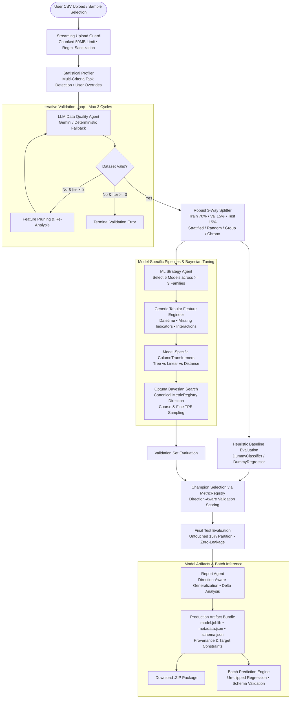

# AutoML-Agent: Production-Grade Agentic Machine Learning Engine

An enterprise-ready, automated Machine Learning system combining **LLM-driven Data Science reasoning (Gemini via LangChain)**, **LangGraph cyclical state orchestration**, **model-specific scikit-learn pipelines**, **canonical metric direction registries**, **Bayesian hyperparameter optimization (Optuna)**, and a **high-performance React frontend**.

---

## 1. System Architecture



---

## 2. Core Engineering Highlights & Remediation

### A. Mathematical & ML Pipeline Correctness
* **Preservation of Raw Regression Semantics**: Unconditional negative prediction clipping (`np.clip(..., a_min=0.0)`) has been eliminated. Raw regression predictions are preserved unless an explicit constraint is defined in artifact metadata.
* **Canonical Metric Registry (`MetricRegistry`)**: Centralized repository of supported metrics (`f1_macro`, `accuracy`, `precision_macro`, `recall_macro`, `roc_auc`, `rmse`, `mae`, `mse`, `r2`) mapping canonical optimization direction (`maximize` vs `minimize`). Optimizers and champion selection strictly adhere to registered directions.
* **Direction-Aware Generalization Reporting**: The report agent evaluates test-vs-validation generalizability based on metric direction (e.g., test RMSE higher than validation RMSE indicates error degradation, whereas test F1 higher than validation F1 indicates positive transfer).
* **Multi-Criteria Task Type Determination**: Replaced naive `n_unique > 20` threshold with continuous float analysis, unique value ratios, and explicit user override support (`problem_type: classification | regression`).
* **Un-inflated Baselines**: Every pipeline run trains and evaluates a `DummyClassifier` or `DummyRegressor` on the exact same partitions, establishing a true heuristic floor.

### B. Leakage Prevention & Robust Splitting
* **Partition Isolation**: Transformers (`SimpleImputer`, `RobustScaler`, `OneHotEncoder`) and supervised feature selections are fitted strictly on the training partition.
* **Robust 3-Way Splitter (`RobustSplitter`)**: Supports Stratified, Random, Group-aware, and Chronological splitting. Automatically detects rare classes (< 3 samples) and gracefully falls back to non-stratified partitioning with clear user warnings rather than crashing.
* **Domain-Agnostic Feature Engineering**: Replaced dataset-specific heuristics with generic tabular transformations: ISO datetime decomposition, missingness indicators, numeric polynomial/ratio interactions, and structured string parsing.

### C. Security & Multi-User Architecture
* **Path Traversal & Injection Defense**: All session identifiers are strictly validated against `^[a-zA-Z0-9_-]{1,64}$`. All artifact paths resolve within the bounded storage root.
* **Streaming Upload Enforcement**: File uploads are inspected chunk-by-chunk with a strict 50MB ceiling, aborting immediately upon exceeding limits to prevent memory exhaustion (DoS).
* **BYOK Isolation**: Client-provided API keys are scoped exclusively to individual session contexts, preventing global process-wide credential mutation.

---

## 3. Verified Benchmark Results

The pipeline was evaluated against small-to-medium datasets using the automated benchmark harness (`scripts/run_benchmark.py`). All models were selected based on validation performance and verified on the untouched 15% test partition.

| Scenario | Task Type | Primary Metric | Baseline Score | Champion Model | Validation Score | Test Score | Inference Latency | Artifact Size | Pipeline Time |
| :--- | :--- | :--- | :--- | :--- | :--- | :--- | :--- | :--- | :--- |
| **Customer Churn** | Binary Classification | `f1_macro` (max) | 0.4304 | CatBoostClassifier | **0.4925** | **0.5989** | 12.15 ms | 207 KB | 18.96 s |
| **California Housing** | Regression | `rmse` (min) | 0.8885 | Ensemble Blend (ExtraTrees + CatBoost) | **0.2429** | **0.2921** | 18.52 ms | 661 KB | 8.86 s |
| **Wine Cultivars** | Multiclass Classification | `f1_macro` (max) | 0.1802 | CatBoostClassifier | **1.0000** | **0.9666** | 3.28 ms | 416 KB | 13.75 s |

*Note: In regression, lower RMSE is better. The ensemble champion cut the baseline error by over 67%.*

---

## 4. Installation & Local Setup

### Prerequisites
* Python 3.10+ (Recommended: Conda environment `ml-env`)
* Node.js 18+ & npm

### 1. Environment Setup
```bash
# Clone the repository
git clone https://github.com/HLDKNotFound/AutoML-Agent.git
cd AutoML-Agent

# Activate Python 3.10 environment
conda activate ml-env
pip install -r requirements.txt

# Install Frontend dependencies
cd frontend
npm install
cd ..
```

### 2. Environment Variables (Optional)
If a Gemini API key is provided, the system leverages Gemini for conversational data quality auditing. If omitted, the system falls back to deterministic rule-based algorithms.
```bash
export GEMINI_API_KEY="your-gemini-api-key"
export LLM_MODEL="gemini-2.5-flash"
```

---

## 5. Running the Application

### Option A: Local Native Processes
**Terminal 1 (Backend - Port 8000):**
```bash
conda activate ml-env
export PYTHONPATH=.
python -m backend.app.main
```

**Terminal 2 (Frontend - Port 5173):**
```bash
cd frontend
npm run dev -- --host 0.0.0.0 --port 5173
```
Open `http://localhost:5173` in your browser.

### Option B: Docker Compose
```bash
# Validate compose configuration
docker compose config

# Build and run containers
docker compose up --build -d
```
*Frontend runs on `http://localhost:5173` (proxied to backend on port 8000).*

---

## 6. Running Tests & Benchmarks

### Complete Automated Test Suite (25 Tests)
```bash
conda activate ml-env
PYTHONPATH=. pytest backend/tests/ -v
```
Test categories covered:
* `test_audit_remediation.py`: Negative regression preservation, MetricRegistry consistency, Optuna error handling, session ID path traversal defenses, streaming upload size enforcement, robust splitting on rare classes, generic feature engineering, and dummy baseline generation.
* `test_backend.py`: End-to-end LangGraph state transitions, model factory, coarse-to-fine Bayesian search, and inference.

### Reproducible Benchmark Suite
```bash
conda activate ml-env
PYTHONPATH=. python scripts/run_benchmark.py
```
Output artifacts are saved to `backend/artifacts/benchmarks/benchmark_run_<timestamp>.json`.

---

## 7. API Reference

| Method | Endpoint | Description | Key Parameters |
| :--- | :--- | :--- | :--- |
| `POST` | `/api/upload` | Upload CSV dataset with chunked 50MB limit | `file: UploadFile` |
| `POST` | `/api/start-pipeline` | Initiate LangGraph AutoML execution | `session_id`, `target_col`, `problem_type` (optional), `api_key` (optional) |
| `GET` | `/api/stream/{session_id}` | Server-Sent Events (SSE) live pipeline stream | `session_id` |
| `GET` | `/api/session/{session_id}` | Fetch current session status & results | `session_id` |
| `GET` | `/api/download/{session_id}` | Download serialized model ZIP package | `session_id` |
| `POST` | `/api/predict` | Zero-refit batch inference on unlabeled CSV | `session_id`, `file: UploadFile` |

---

## 8. Limitations & Production Considerations

1. **Authentication & Multi-Tenant Isolation**: The current deployment uses session-based token isolation and path sandboxing. In a public cloud deployment, wrap the backend with OAuth2/JWT authentication and mount object storage (e.g., S3/GCS) rather than local disk.
2. **Compute Scaling**: Hyperparameter optimization runs locally on process threads via Optuna. For large-scale datasets (>1M rows), distributed workers (e.g., Celery, Ray, or Kubernetes Jobs) are recommended.
3. **Model Artifact Security**: Model artifacts are serialized with `joblib`. As with all Python object serialization, artifacts should be loaded only from trusted storage roots.
